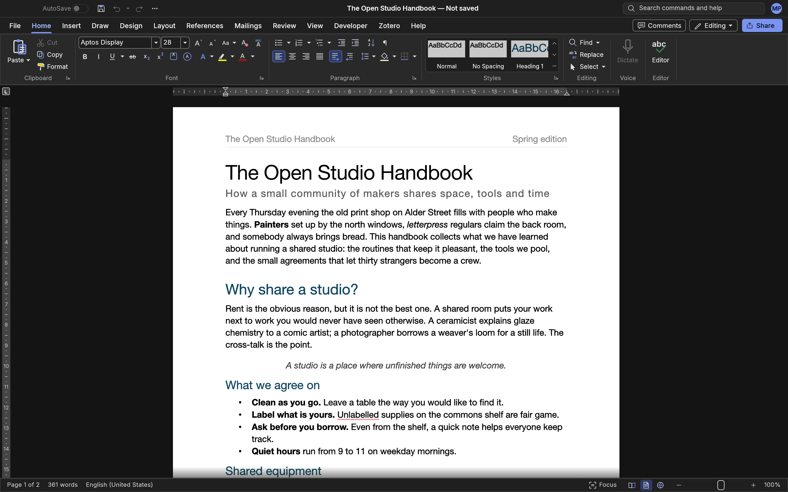
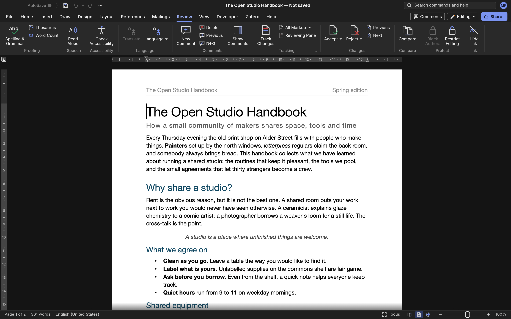
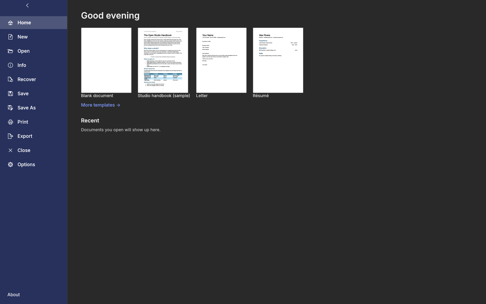

# Mac-Word

A native, RAM-lean, Microsoft Word-compatible word processor for macOS — forked from
[WordCraft](https://github.com/storytold/wordcraft) and maintained by **Manik Pruthi**.

<p align="center">
  
</p>

<table>
<tr>
<td width="50%" valign="top"><p align="center"><sub><b>Review.</b> Track changes, comment balloons, accept and reject, spelling and grammar.</sub></p></td>
<td width="50%" valign="top"><p align="center"><sub><b>File.</b> Templates, recent documents, document properties, export and print.</sub></p></td>
</tr>
</table>

Mac-Word is the full WordCraft word processor — ribbon, styles, tables, references, review, mail
merge, `.docx` read/write and PDF export — rebranded for macOS, with its update machinery removed
and its memory and start-up paths tuned for an 8 GB MacBook. See
[Differences from WordCraft](#differences-from-wordcraft). It is a native app: pure Rust with a
[Metal](https://developer.apple.com/metal/)-rendered [egui](https://github.com/emilk/egui) interface.
There is no Electron, no web view and no bundled browser.

## Features

- **Word's interface.** Ribbon tabs, Quick Access Toolbar, Backstage File page, rulers, Navigation
  pane, Styles gallery with live previews, status bar, context menus and Word's keyboard shortcuts.
- **Writing.** Fast typing with IME, smart quotes, AutoCorrect, automatic lists, word/sentence/
  paragraph selection, drag-select, clipboard with formatting, undo/redo, Find & Replace with regex.
- **Formatting.** Fonts, sizes, bold/italic/underline, strike, sub/superscript, caps, highlight,
  colours, character spacing, Format Painter, Change Case and Clear Formatting.
- **Paragraphs and pages.** Alignment, indents, spacing, tabs and leaders, borders, shading,
  keep-with-next, widow/orphan control, margins, orientation, columns, sections, headers and
  footers, page numbers, watermarks, page borders, line numbers and hyphenation.
- **Styles and themes.** Word's built-in style set, create/modify/update styles, style sets and themes.
- **Lists and tables.** Bullets, numbering, multilevel lists, tables with banded styles, merged
  cells, repeated header rows, sorting, formulas and text ↔ table conversion.
- **Objects.** Pictures (crop, recolour, transparency, styles), shapes, text boxes, icons, charts,
  SmartArt, drawing canvas, floating position and text wrapping.
- **References.** Tables of contents, footnotes and endnotes, citations (APA, MLA, Chicago, IEEE),
  bibliography, captions, table of figures, cross-references, index and table of authorities.
- **Review.** Comments in margin balloons or a pane, track changes, accept/reject, document
  compare, restrict editing, accessibility checker, document inspector, thesaurus and word count.
- **Mailings.** Mail merge from CSV and spreadsheet recipient lists, merge fields, address blocks,
  greeting lines, rules, preview and finish-to-document; envelopes and labels.
- **Files.** Opens and saves `.docx`, `.docm`, `.dotx` and `.dotm`; imports legacy `.doc`/`.dot`,
  `.odt`, `.rtf`, `.html`, `.mht`, Word XML, `.md`, `.tex` and `.txt`; exports PDF with selectable
  text, links and bookmarks, plus HTML/Markdown/RTF/ODT/TXT. Every Word file type the app opens is
  registered with macOS under its public type identifier, so Finder's Open With offers Mac-Word
  for all of them without making it the default.
- **View.** Print, Web, Draft, Outline and Read modes, dark mode, Focus, Full Screen, zoom, and a
  native window per document with **Arrange All**, **View Side by Side** and **Synchronous
  Scrolling**.
- **Insert › Screenshot** takes an interactive screen selection and inserts it
  as a picture; the window keeps drawing while you pick the area.
- **Agents and automation.** Every action is a command: a JSON control channel, an MCP server and a
  command-line tool (`mac-word-cli`). No telemetry and no update checks.

The honest area-by-area parity picture is kept in [docs/target-app-parity.md](docs/target-app-parity.md),
[docs/gaps.md](docs/gaps.md) and the generated [parity checklist](docs/parity-checklist.md).

## Requirements

- macOS 11 (Big Sur) or later, Apple silicon or Intel. The packaged app is a universal binary.
- To build from source: Rust 1.95+ through `rustup`, Xcode Command Line Tools (`lipo`, `codesign`,
  `iconutil`), and about 12 GB of free disk space for a universal release build.
- Optional full language data: check out [craft-i18n](https://github.com/storytold/craft-i18n) at the
  commit in `craft-i18n.rev` into `../craft-i18n`, or set `CRAFT_I18N_DIR` to its absolute path.
  Without it the app builds with the English interface and English proofing, and only the built-in
  hyphenation rules.

## Install

### Prebuilt DMG

1. Run `./package.sh` (or use `release/Mac-Word-1.0.0.dmg` from a previous run).
2. Open the DMG and drag **Mac-Word** into **Applications**.
3. The app is ad-hoc signed. On first launch, right-click it in Applications and choose **Open**.

### Build from source

```sh
./build.sh            # debug build → ~/Library/Caches/MacWordBuild/Mac-Word.app
./build.sh release    # optimised universal build, same location
./package.sh          # release build + release/Mac-Word-1.0.0.dmg
```

The command-line tool is written next to the app as `~/Library/Caches/MacWordBuild/mac-word-cli`.

For development the Cargo workspace runs directly:

```sh
CRAFT_I18N_DIR="$PWD/../craft-i18n" cargo run --release -p wordcraft -- --sample
```

There is no hosted CI. Run the checks (fmt, clippy, tests, layering) locally before committing:

```sh
cargo xtask ci
```

Releases are built by hand with `./package.sh`; see [docs/releasing.md](docs/releasing.md).

## Permissions

- **Files and folders**: normal macOS file access; the app is not sandboxed, so it opens files by
  path, from Finder, from the command line and by drag and drop.
- **Screen Recording**: needed the first time you use **Insert › Screenshot** (the system asks).
  The capture is performed by macOS's own `screencapture` tool, not by screen-reading code in the app.
- **Printing**: through the system print dialog and spooler; no extra permission.
- **Automation**: the optional localhost control channel is off unless started with `--control`.

## Usage

| Action | Shortcut |
|---|---|
| Save / Save As / Open / New | ⌘S / ⌘⇧S / ⌘O / ⌘N |
| Print / Find | ⌘P / ⌘F |
| Bold / Italic / Underline | ⌘B / ⌘I / ⌘U |
| Undo / Redo | ⌘Z / ⌘⇧Z |
| Cut / Copy / Paste | ⌘X / ⌘C / ⌘V |
| Select all / Find next | ⌘A / ⌘G |
| Spelling & Grammar | F7 |
| Repeat last action | F4 |
| Field codes | ⌥F9 |
| New window / Switch windows | View › Window |
| Arrange All / Side by Side / Sync Scrolling | View › Window |
| Full screen | ⌃⌘F or F11 |

Everything in the ribbon is also a command; `mac-word-cli commands` lists all of them.

## How it works

Mac-Word keeps WordCraft's layered Rust architecture:

| Layer | Crate | Job |
|---|---|---|
| L0 | `wordcraft-geom` | units and measurements |
| L1 | `wordcraft-doc`, `wordcraft-fonts` | document model and edit primitives; fonts, shaping and fallback |
| L2 | `wordcraft-layout`, `wordcraft-docx`, `wordcraft-formats` | line breaking, pagination, tables, notes; OOXML; ODT/RTF/HTML/Markdown/TeX/TXT |
| L3 | `wordcraft-render`, `wordcraft-pdf` | `vello_cpu` page rasteriser; PDF through Krilla |
| L4 | `wordcraft-engine` | session, undo, command registry, feature catalog, samples, I/O |
| L5 | `wordcraft-mcp` | MCP server |
| L6 | `wordcraft-ui-egui` | native Metal interface |
| apps | `wordcraft`, `wordcraft-cli`, `wordcraft-web` | desktop, command line, browser |

The UI is thin: it reads `Session` state and acts only through command ids, so the ribbon,
keyboard, control channel, CLI and MCP all reach the same behaviour. Layering is enforced by
`cargo xtask layers`; the word processor never depends on system UI or a browser.

## Memory and speed

The app is built for an 8 GB Mac. Measured with `scripts/bench-foreground.py` on an Apple-silicon
Mac: the release build opened with `open` (in front, as you use it) on a 40-section, 17,000-word
document, physical footprint from `footprint` once each step settles:

| Step | Footprint |
|---|---:|
| Start screen (no document) | 95 MB |
| Built-in sample, idle | 120 MB |
| 100% zoom | 143 MB |
| Page width | 162 MB |
| Page width, scrolled to the end | 215 MB |
| 300% zoom | 216 MB |

Pages are drawn from native-resolution 256-pixel tiles and only the tiles on screen and half a
screen around it are kept, so memory stays flat as you zoom and scroll. The caret stops blinking
5 seconds after the last key, click or caret move (as Word does on Windows' default settings), which
lets Metal release its upload memory while the window is idle. The window keeps at most two
drawables, dual-GPU Macs stay on the integrated GPU, and each rendered tile goes to the GPU without
an extra copy. The installed-font catalog is cached between launches, so only the first launch
scans the fonts. Full methodology, cache limits and reproduction commands are in
[docs/memory.md](docs/memory.md).

## Differences from WordCraft

- **Identity.** Named Mac-Word, version 1.0.0, bundle id `com.manikpruthi.mac-word`, original icon,
  settings and logs under Mac-Word. About shows only the app's name, version and
  licence (crediting WordCraft); the Contributors, Models and Language data pages (the spelling
  dictionaries' licences require their text) stay in the binary and open on their own through `ui.dialog`.
- **Private.** No update checks, self-updater, update URLs, Discord or ArtCraft links: the app
  never phones home.
- **Windows.** View › Window › Arrange All, View Side by Side and Synchronous Scrolling. While
  scrolling in sync, the window being scrolled leads and its partner moves by the same distance, as
  in Word.
- **Insert › Screenshot** through macOS's `screencapture`, run by the desktop front end on its own
  thread so the window keeps drawing while an area is picked.
- **Authoring name.** Comments and tracked changes are signed with the Mac account's full name until
  a User Name is set.
- **File types.** `.docx`, `.docm`, `.dotx`, `.dotm`, `.doc`, `.dot`, `.mht` and Word XML are
  registered with macOS under their public type identifiers.
- **Memory.** Tiled page rendering, an idle caret, two window drawables, integrated GPU on dual-GPU
  Macs, a 64 MB decoded-picture cache, undo depth 100, a 10,000-glyph cache, four render workers and
  a cached font catalog.
- **Build.** Universal `build.sh` / `package.sh`, fat LTO with one codegen unit and stripped
  symbols; extended attributes are cleared before signing. Tests that need the full language data
  skip cleanly without it.

Measured memory and start-up numbers, the methodology and the exact cache limits are in
[docs/memory.md](docs/memory.md). Details of the rebrand and how to pull upstream changes are in
[docs/FORK.md](docs/FORK.md).

## Project layout

```
build.sh / package.sh        universal app + DMG
assets/app-icon/             original Mac-Word icon (generator in packaging/icons/)
apps/wordcraft/              desktop app (binary is shipped as Mac-Word)
apps/wordcraft-cli/          command-line tool (shipped as mac-word-cli)
apps/wordcraft-web/          WebAssembly build
crates/                      engine, document, layout, rendering, formats, MCP, UI
docs/screenshots/            README screenshots
docs/                        architecture, parity, gaps and fork documentation
packaging/macos/             Info.plist template (Word file types) and entitlements
scripts/bench-memory.py      start-up and memory benchmark used for docs/memory.md
contributors/                upstream contributor data (the Contributors page)
xtask/                       local checks (`cargo xtask ci`) and version bumps
```

## Known gaps

Mac-Word inherits WordCraft's alpha-stage gaps, and this fork deliberately does not bundle
external services. Not implemented: Online Pictures, Online Video, 3D Models, Office Add-ins,
Dictate, Translate, Ink Equation / Ink to Math, and full Block Authors. Charts and SmartArt created
in Mac-Word are editable; charts and SmartArt from Word are drawn but remain read-only. Macro
(`.docm`) content is preserved but not executed. VBA, cloud storage, real-time co-authoring and PDF
reflow are out of scope for this initial release. The same list, ranked, is in
[docs/gaps.md](docs/gaps.md).

Known limitations of this build:

- Some messages from deep in the file readers (encrypted-file and Zotero errors, a few log lines)
  and the `Application` property written into saved `.docx` files still say WordCraft.
- Over the control channel or MCP, `view.sideBySide` with a single window answers `value: true`;
  the app then reports that a second window is needed and turns the mode off.
- Ad-hoc signed, not notarized: the first launch needs right-click › Open.
- `cargo test -p wordcraft-fonts` fails `a_thai_run_with_latin_falls_back_to_one_face` on macOS
  27.2, whose Thonburi has no OpenType layout tables; upstream WordCraft fails it the same way.

## Fork and upstream

Mac-Word is a fork of [storytold/wordcraft](https://github.com/storytold/wordcraft) (MIT OR
Apache-2.0). The upstream remote is kept for comparison:

```sh
git remote -v                 # upstream → https://github.com/storytold/wordcraft
git fetch upstream
git diff upstream/main --stat
```

Upstream documentation (architecture, parity checklists, format notes, agent API) remains in
`docs/` and is maintained alongside the code. Internal crate names still say `wordcraft-*`; they
are not user-visible and keeping them makes upstream merges tractable. User-visible names, paths,
metadata, logs and the bundle are Mac-Word.

## License

Mac-Word is dual-licensed under [MIT](LICENSE-MIT) or [Apache-2.0](LICENSE-APACHE), at your option,
like the upstream project. Original WordCraft code is copyright the WordCraft contributors;
Mac-Word changes are copyright © 2026 Manik Pruthi. Required notices are in [NOTICE](NOTICE);
bundled fonts and other third-party assets keep their own licences, listed with author and source
in [ATTRIBUTION.md](ATTRIBUTION.md).
